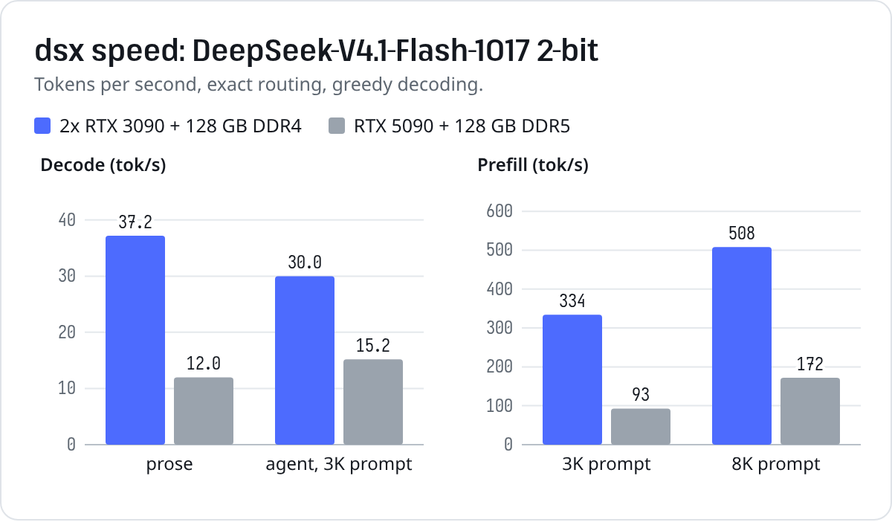
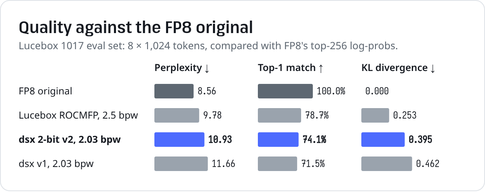

# dsx

Run **DeepSeek-V4.1-Flash-1017** (552B MoE + 196B Engram) at full routing on hardware you can own or rent: a
desktop with two RTX 3090s, or one AMD Instinct MI325X. Two runners built for this one model, each with its own
quant, sharing one server (OpenAI and Anthropic compatible, tool calls, streaming, web UI).

| | **NVIDIA desktop** | **AMD MI325X** |
|---|---|---|
| Runner | [`nvidia/`](nvidia/), Rust + CUDA | [`amd/`](amd/), Rust + HIP |
| Model | [lxe/DeepSeek-V4.1-Flash-1017-dsx-2bit](https://huggingface.co/lxe/DeepSeek-V4.1-Flash-1017-dsx-2bit) | [lxe/DeepSeek-V4.1-Flash-1017-dsx-mxfp4](https://huggingface.co/lxe/DeepSeek-V4.1-Flash-1017-dsx-mxfp4) |
| Size | 148 GB (per-expert 1.75-3.4 bit, Q8_0 dense) | 270 GB (59% of experts MXFP4 as trained, 41% 3-bit, dense FP8) |
| Where the weights live | VRAM + RAM arena + NVMe, hottest first | all in 256 GiB of HBM |
| Decode | 30-37 tok/s (2x RTX 3090), 12-15 tok/s (RTX 5090) | 110-114 tok/s at 4K-256K context; up to 1.7x on code with DSpark drafts |
| Prefill | 334 / 508 tok/s (3K / 8K prompt, 2x 3090) | 1,640 / 1,160 tok/s (16K / 128K prompt) |
| Context | 131K | 256K |
| Quality vs FP8 (KL / top-1) | 0.395 / 74.1% | 0.049 / 90.6% |

Both use exact routing (no expert pruning, no router bias). Quality is measured on
[Lucebox's 1017 eval set](https://huggingface.co/Lucebox/DeepSeek-V4.1-Flash-1017-ROCMFP-GGUF) (8 x 1024 tokens
against the FP8 model's top-256 log-probs). The Engram tables (203 GB) come from the official checkpoint for both.

## NVIDIA desktop





| | 2x RTX 3090, 128 GB DDR4 | RTX 5090, 128 GB DDR5 |
|---|---:|---:|
| Decode, prose | 37.2 tok/s | 12.0 tok/s |
| Decode, 3K-token agent prompt | 30.0 tok/s | 15.2 tok/s |
| Prefill, 3K / 8K tokens | 334 / 508 tok/s | 93 / 172 tok/s |

On the single-GPU box, ~40 GB of experts live on disk, which sets its speed.

```bash
# weights: the quant, plus the Engram tables and tokenizer from the official checkpoint
hf download lxe/DeepSeek-V4.1-Flash-1017-dsx-2bit --local-dir dsx-2bit
hf download deepseek-ai/DeepSeek-V4.1-Flash-1017 --local-dir v41-1017 \
  --include model.safetensors.index.json model-00047-of-00048.safetensors model-00048-of-00048.safetensors tokenizer.json

# build (86 = RTX 30xx, 120 = RTX 50xx) and serve
CUDA_ARCHS=86 cargo build --release -p dsx --features cuda
./target/release/dsx-server --model dsx-2bit/DeepSeek-V4.1-Flash-1017-dsx-2bit-00001-of-00004.gguf \
  --engram v41-1017 --tokenizer v41-1017/tokenizer.json --host 0.0.0.0 --port 8090 \
  --ctx 131072 --gpu0-gb=-1.5 --gpu1-gb=-1.0 --arena-gb 110 --rank dsx-2bit/expert-rank.json
```

| | |
|---|---|
| GPU | NVIDIA, 24 GB+ (sm_86 or sm_120), CUDA 13 |
| Memory | ~140 GB of VRAM + RAM for the experts |
| CPU | x86 with AVX2 (AVX-VNNI preferred) |
| Disk | ~350 GB: the quant (148 GB) + the Engram shards (203 GB) |

### Placement

Experts are spread across VRAM, a RAM arena and the file, hottest first.

| Flag | |
|---|---|
| `--gpu0-gb`, `--gpu1-gb` | GB of experts per GPU; negative = all free VRAM minus that much; `--gpu1-gb 0` for one GPU |
| `--arena-gb` | RAM for experts the CPU computes |
| `--rank` | expert hotness order (`expert-rank.json` from the quant repo) |
| `DSX_ADAPT=N` | GPU0 expert swaps per token to follow the conversation (default 8; 0 = static) |

| Machine | Flags |
|---|---|
| 2x 24 GB GPU, 128 GB RAM | `--gpu0-gb=-1.5 --gpu1-gb=-1.0 --arena-gb 110` |
| 1x 32 GB GPU, 128 GB RAM | `--gpu0-gb=-2.0 --gpu1-gb 0 --arena-gb 80`, `DSX_ADAPT=0` |

### How it works

| Part | Where it runs |
|---|---|
| Attention, shared expert, routers (Q8_0) | GPU0 |
| Hottest routed experts (~3,300 of 15,360) | VRAM on both GPUs; GPU0's set adapts to the conversation |
| Remaining experts | 14 CPU threads, straight from a hugepage RAM arena |
| Engram n-gram rows | read from the official shards by a prefetch thread |

- Within a token, GPU0 posts each layer's expert picks to shared memory and the CPU and GPU1 answer through flags,
  so the whole token runs without waiting on the host.
- Prefill runs the first half of the layers on every token and the second half only on the tokens it can still affect.
- The server reuses the cached prefix across turns.

## AMD MI325X

One AMD Instinct MI325X (gfx942, 256 GiB HBM3E) holds the whole model except the Engram tables, so the checkpoint's
own MXFP4 experts can stay as they are for the 59% most used; the rest get a fitted 3-bit codebook.

| 1x MI325X | |
|---|---:|
| Decode at 4K / 128K / 256K context | 114 / 112 / 110 tok/s |
| With DSpark drafts (greedy) | 1.4-1.7x on code, 1.2-1.4x on math, ~1.0x on prose |
| Prefill, 4K / 16K / 128K-token prompt | 1,840 / 1,640 / 1,160 tok/s |
| Cost at $3.80/h, one stream | $9.3 per million generated tokens, $0.64 per million prompt tokens |

```bash
hf download lxe/DeepSeek-V4.1-Flash-1017-dsx-mxfp4 --local-dir dsx-mxfp4
hf download deepseek-ai/DeepSeek-V4.1-Flash-1017 --local-dir v41-1017 \
  --include config.json tokenizer.json model.safetensors.index.json model-00047-of-00048.safetensors model-00048-of-00048.safetensors
cp dsx-mxfp4/dsx-engram.json v41-1017/

cargo build --release -p dsx-amd      # ROCm 7, gfx942
DSXA_WEIGHTS=dsx-mxfp4/DeepSeek-V4.1-Flash-1017-dsx-mxfp4-00001-of-00006.gguf \
  ./target/release/dsx-amd serve --model v41-1017 --ctx 262144 --host 0.0.0.0 --port 8090
```

`--model` is the official checkpoint directory (config, tokenizer, Engram shards, plus `dsx-engram.json` from the
quant repo). `DSXA_DSPARK=3` adds the checkpoint's DSpark draft layers for greedy requests; they are read from the
official `mtp.*` tensors (add `model-00044-of-00048.safetensors` .. `model-00046-of-00048.safetensors` to the
download) and take 6.5 GB of HBM, so 1,613 cold experts go to 3-bit
(KL 0.056). Measurements and design notes: [FINDINGS-AMD.md](FINDINGS-AMD.md).

## Using the server

Both runners serve the same API on `--port`. Open `http://localhost:8090/` for the web UI, or use any OpenAI client
with base URL `http://localhost:8090/v1`:

```bash
curl http://localhost:8090/v1/chat/completions -H 'content-type: application/json' -d '{
  "model": "deepseek-v4.1-flash", "stream": true, "reasoning_effort": "none",
  "messages": [{"role": "user", "content": "Write a haiku about MoE routing."}] }'
```

Thinking is on by default; `"reasoning_effort": "none"` or `"thinking": {"type": "disabled"}` turns it off.

### Clients

Any OpenAI-compatible client works. For the [pi](https://github.com/badlogic/pi-mono) coding agent, add to
`~/.pi/agent/models.json`:

```json
{ "providers": { "dsx": {
  "baseUrl": "http://localhost:8090/v1", "api": "openai-completions", "apiKey": "none", "authHeader": false,
  "compat": { "supportsDeveloperRole": false, "supportsReasoningEffort": true, "maxTokensField": "max_tokens" },
  "models": [{ "id": "deepseek-v4.1-flash", "reasoning": true, "input": ["text"], "contextWindow": 131072,
               "maxTokens": 8192, "thinkingLevelMap": { "off": "none", "high": "high" } }] } } }
```

```bash
pi --provider dsx --model deepseek-v4.1-flash:off
```

### Tools

`target/release/dsx` (NVIDIA runner):

| Command | |
|---|---|
| `gen` | prefill + greedy decode, with timings |
| `eval` | KL / top-1 / perplexity against teacher log-probs |
| `cmp`, `ref` | GPU against the CPU reference implementation |

## Repo

| Path | |
|---|---|
| [`core/`](core/) | shared by both runners: config, GGUF / safetensors readers, block formats, the CPU reference forward and DSpark reference, the server and web UI |
| [`nvidia/`](nvidia/) | the desktop runner: CUDA kernels, expert placement over VRAM / RAM / disk, CPU expert kernels ([nvidia/README.md](nvidia/README.md)) |
| [`amd/`](amd/) | the MI325X runner: HIP kernels, the MXFP4 + 3-bit build and its export, DSpark on the GPU |
| [`quant/`](quant/) | the 2-bit quantization pipeline, with native CUDA GPTQ |
| [`cards/`](cards/) | the Hugging Face model cards ([dsx-2bit](cards/dsx-2bit/README.md), [dsx-mxfp4](cards/dsx-mxfp4/README.md)) |
| [`FINDINGS.md`](FINDINGS.md), [`FINDINGS-AMD.md`](FINDINGS-AMD.md) | research notes and measurements |

One Cargo workspace: `cargo build --release` builds `core` and the NVIDIA runner (CPU-only without
`--features cuda`); `-p dsx-amd` builds the AMD runner (needs ROCm). Binaries land in `target/release/`.

The 2-bit quant uses dsx's per-expert formats (ternary, Q2_0, Q3_K per expert) and loads in the NVIDIA runner; the
MXFP4 + 3-bit build loads in the AMD runner.

## Credits

[DeepSeek](https://huggingface.co/deepseek-ai) for the model (MIT) ·
[Xolotl / Strata](https://github.com/Indras-Mirror/Xolotl) for the GSQ tools and V4.1 GGUF format (MIT) ·
[Lucebox](https://huggingface.co/Lucebox/DeepSeek-V4.1-Flash-1017-ROCMFP-GGUF) for the eval set ·
antirez for the calibration prompts · the web UI is [llama.cpp](https://github.com/ggml-org/llama.cpp)'s, by Georgi
Gerganov and the ggml authors (MIT), vendored in [`core/webui`](core/webui) with its license.

MIT license.
