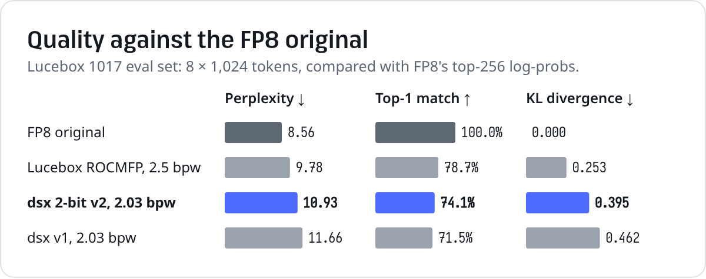
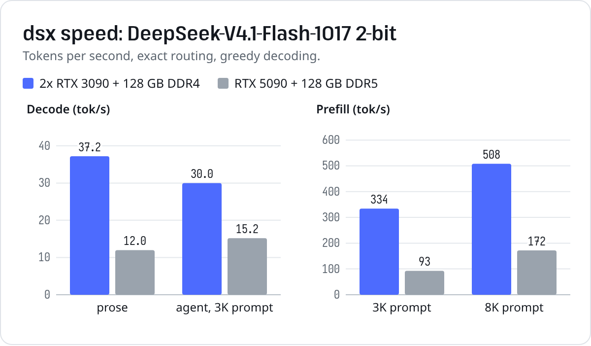
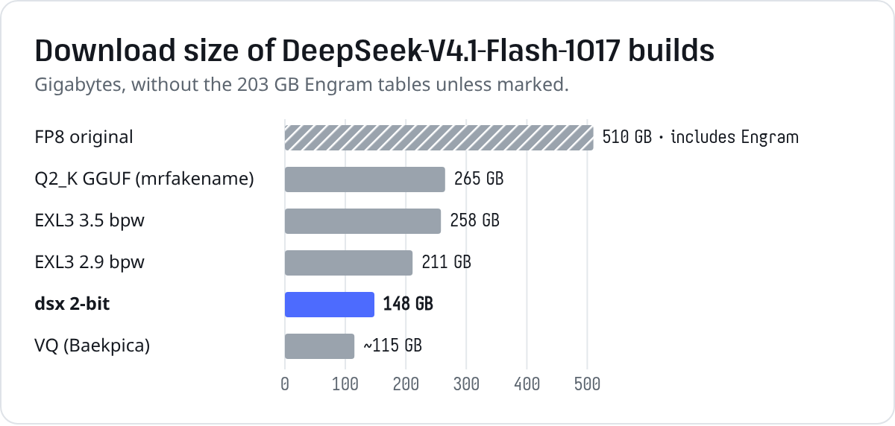
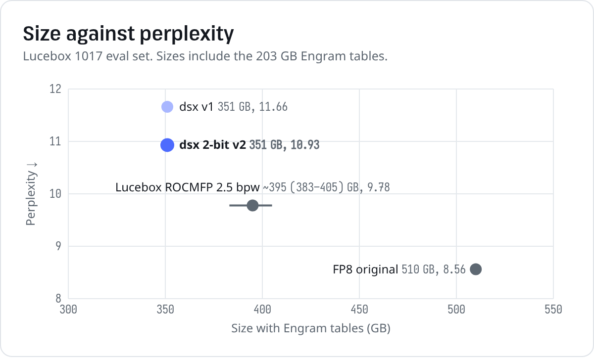

# DeepSeek-V4.1-Flash-1017 · dsx 2-bit

DeepSeek-V4.1-Flash-1017 (552B MoE + 196B Engram) in 148 GB, built to run on two RTX 3090s and 128 GB of RAM with
exact routing. Runs on [**dsx**](https://github.com/lxe/dsx), a Rust + CUDA engine made for this model.

| | |
|---|---|
| Size | 148 GB (4 parts) + the official Engram shards (203 GB) |
| Quality vs FP8 | KL 0.395 · top-1 74.1% · perplexity 10.93 (FP8: 8.56) |
| Speed, 2x RTX 3090 | 30-37 tok/s decode · 334-508 tok/s prefill |
| Runtime | [dsx](https://github.com/lxe/dsx) (OpenAI / Anthropic API, web UI) |

> Runs on dsx: the file stores each expert in its own format (ternary, Q2_0 or Q3_K).

## Quality



Measured on [Lucebox's 1017 eval set](https://huggingface.co/Lucebox/DeepSeek-V4.1-Flash-1017-ROCMFP-GGUF):
8 × 1024 tokens against the FP8 model's top-256 log-probs.

| | Experts | KL ↓ | Top-1 ↑ | Perplexity ↓ |
|---|---|---:|---:|---:|
| FP8 / FP4 original | FP4 | 0 | 100% | 8.56 |
| Lucebox ROCMFP | 2.5 bpw | 0.253 | 78.7% | 9.78 |
| **dsx 2-bit** | **2.03 bpw** | **0.395** | **74.1%** | **10.93** |

## Speed



Greedy, exact routing, 400 generated tokens.

| | 2x RTX 3090, 128 GB DDR4 | RTX 5090, 128 GB DDR5 |
|---|---:|---:|
| Decode, prose | 37.2 tok/s | 12.0 tok/s |
| Decode, 3K-token agent prompt | 30.0 tok/s | 15.2 tok/s |
| Prefill, 3K / 8K tokens | 334 / 508 tok/s | 93 / 172 tok/s |

Decode speed comes down to how many experts fit in VRAM + RAM. Two 24 GB GPUs + 128 GB hold all of them; one 32 GB GPU
+ 128 GB leaves ~40 GB of experts to be read from disk.

## Size





## Run

```bash
# the quant: download, join, verify
hf download lxe/DeepSeek-V4.1-Flash-1017-dsx-2bit --local-dir dsx-2bit
bash dsx-2bit/reassemble.sh dsx-2bit

# Engram tables + tokenizer from the official checkpoint
hf download deepseek-ai/DeepSeek-V4.1-Flash-1017 --local-dir v41-1017 \
  --include model.safetensors.index.json model-00047-of-00048.safetensors model-00048-of-00048.safetensors tokenizer.json

# the engine
git clone https://github.com/lxe/dsx && cd dsx/engine
CUDA_ARCHS=86 cargo build --release --features cuda      # 86 = RTX 30xx, 120 = RTX 50xx

./target/release/dsx-server --model ../../dsx-2bit/DeepSeek-V4.1-Flash-1017-dsx-2bit.gguf \
  --engram ../../v41-1017 --tokenizer ../../v41-1017/tokenizer.json --host 0.0.0.0 --port 8090 \
  --ctx 131072 --gpu0-gb=-1.5 --gpu1-gb=-1.0 --arena-gb 110 --rank ../../dsx-2bit/expert-rank.json
```

Open `http://localhost:8090/` for the web UI, or point any OpenAI-compatible client at `http://localhost:8090/v1`:

```python
from openai import OpenAI
client = OpenAI(base_url="http://localhost:8090/v1", api_key="none")
r = client.chat.completions.create(model="deepseek-v4.1-flash", reasoning_effort="none",
                                   messages=[{"role": "user", "content": "Merge overlapping intervals in Python."}])
print(r.choices[0].message.content)
```

Thinking is on by default; `"reasoning_effort": "none"` turns it off.

## Hardware sizing

VRAM + RAM should hold ~140 GB of experts.

| Machine | Flags |
|---|---|
| 2x 24 GB GPU, 128 GB RAM | `--gpu0-gb=-1.5 --gpu1-gb=-1.0 --arena-gb 110` |
| 1x 32 GB GPU, 128 GB RAM | `--gpu0-gb=-2.0 --gpu1-gb 0 --arena-gb 80`, env `DSX_ADAPT=0` |

Also needed: CUDA 13, Rust, an AVX2 CPU, ~350 GB of disk.

## How it was made

- **Experts:** each of the 15,360 routed experts gets ternary (1.75 bpw), Q2_0 (2.25) or Q3_K (3.44), picked by its
  measured output error. One bit budget is shared across layers 2-36, so sensitive layers get up to 2.75 bpw and
  forgiving ones ~1.76. Average: 2.03 bpw.
- **Method:** GPTQ per expert, with Hessians from a layer-by-layer calibration pass through DeepSeek's reference
  `model.py` (GSQ pipeline from [Xolotl](https://github.com/Indras-Mirror/Xolotl)).
- **Calibration text:** 128 × 2048 tokens of coding-agent sessions and antirez's agent and code prompts.
- **Dense weights:** Q8_0. **Engram:** unquantized, read from the official shards.

Pipeline: [github.com/lxe/dsx/tree/main/quant](https://github.com/lxe/dsx/tree/main/quant).

## Files

| File | |
|---|---|
| `DeepSeek-V4.1-Flash-1017-dsx-2bit.gguf.part-0N-of-04` | the GGUF, split into byte ranges |
| `reassemble.sh` | checks, joins and verifies the parts |
| `SHA256SUMS` | checksums of the parts and the joined file |
| `expert-rank.json` | expert hotness, used to place experts in VRAM |
| `results/` | raw quality and speed logs |
| `assets/` | charts and the script that draws them |

The earlier 2.0-bpw-per-layer build (KL 0.462) is at revision [`v1`](https://huggingface.co/lxe/DeepSeek-V4.1-Flash-1017-dsx-2bit/tree/v1).

## Credits

[DeepSeek](https://huggingface.co/deepseek-ai) for the model (MIT) ·
[Xolotl / Strata](https://github.com/Indras-Mirror/Xolotl) for the GSQ tools and V4.1 GGUF format ·
[Lucebox](https://huggingface.co/Lucebox/DeepSeek-V4.1-Flash-1017-ROCMFP-GGUF) for the eval set ·
antirez for the calibration prompts ·
[llama.cpp](https://github.com/ggml-org/llama.cpp) (Georgi Gerganov and the ggml authors, MIT) for the web UI.
